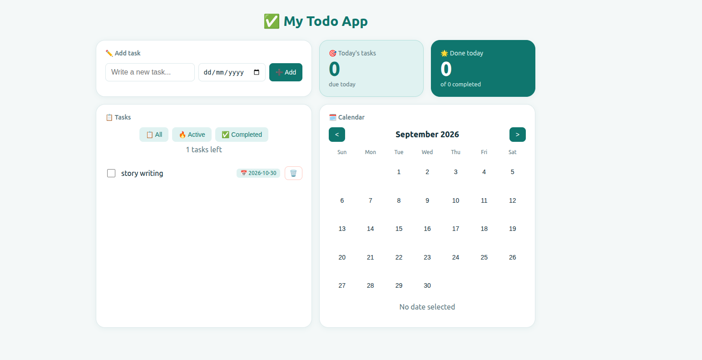

# ✅ My Todo App

A bento-style todo app built with React and Vite. Add tasks with due dates,
see how many are due today, and spot busy days on a calendar.

## ✨ Features

- Add, complete, edit (double-click) and delete tasks
- Due dates for tasks
- Filters: All, Active, Completed
- "Tasks left" counter and a Clear completed button
- Today's tasks and Done today stat cards
- Calendar view: dots on days with pending tasks, ⭐ when all are done
- Tasks stay saved after refresh (localStorage)
- Responsive bento layout for desktop and mobile

> Data is stored in your browser's localStorage, so each visitor has their own list.

## 🛠️ Tech stack

- React (hooks: `useState`, custom `useLocalStorage`)
- Vite
- CSS (Grid, custom properties)

## 🚀 Run locally

    git clone https://github.com/ReachalJain/todo-app.git
    cd todo-app
    npm install
    npm run dev

## 📁 Project structure

    src/
      components/   TodoForm, TodoList, TodoItem, FilterBar, StatCard, CalendarView
      hooks/        useLocalStorage
      App.jsx
